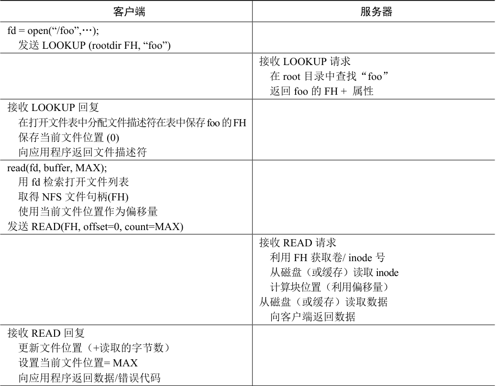

# 48.6 从协议到分布式文件系统

希望你已对该协议如何转换为文件系统有所了解。客户端文件系统追踪打开的文件，通常将应用程序的请求转换为相关的协议消息集。服务器只响应每个协议消息，每个协议消息都具有完成请求所需的所有信息。

例如，考虑一个读取文件的简单应用程序。表48.1 展示了应用程序进行的系统调用，以及客户端文件系统和文件服务器响应此类调用时的行为。

关于该表有几点说明。首先，请注意客户端如何追踪文件访问的所有相关状态（state），包括整数文件描述符到NFS 文件句柄的映射，以及当前的文件指针。这让客户端能够将每个读取请求（你可能注意到，读取请求没有显式地指定读取的偏移量），转换为正确格式的读取协议消息，该消息明确地告诉服务器，从文件中读取哪些字节。成功读取后，客户端更新当前文件位置，后续读取使用相同的文件句柄，但偏移量不同。

其次，你可能会注意到，服务器交互发生的位置。当文件第一次打开时，客户端文件系统发送LOOKUP 请求消息。实际上，如果必须访问一个长路径名（例如/home/remzi/foo.txt），客户端将发送3 个LOOKUP：一个在/目录中查找home，一个在home 中查找remzi，最后一个在remzi 中查找foo.txt。

第三，你可能会注意到，每个服务器请求如何包含完成请求所需的所有信息。这个设计对于从服务器故障中优雅地恢复的能力至关重要，接下来将更详细地讨论。这确保服务器不需要状态就能够响应请求。

表格文字

| 客户端 | 服务器 |
| --- | --- |
| fd = open(“/foo”,…); 发送LOOKUP (rootdir FH, “foo”) |  |
|  | 接收LOOKUP 请求 在root 目录中查找“foo” 返回foo 的FH + 属性 |
| 接收LOOKUP 回复 在打开文件表中分配文件描述符在表中保存foo的FH 保存当前文件位置 (0) 向应用程序返回文件描述符 |  |
| read(fd, buffer, MAX); 用fd 检索打开文件列表 取得NFS 文件句柄(FH) 使用当前文件位置作为偏移量 发送READ(FH, offset=0, count=MAX) |  |
|  | 接收READ 请求 利用FH 获取卷/ inode 号 从磁盘（或缓存）读取inode 计算块位置（利用偏移量） 从磁盘（或缓存）读取数据 向客户端返回数据 |
| 接收READ 回复 更新文件位置（+读取的字节数） 设置当前文件位置= MAX 向应用程序返回数据/错误代码 |  |

read(fd, buffer, MAX);除了偏移量=MAX，设置当前文件位置= 2\*MAX 外，都一样read(fd, buffer, MAX);除了偏移量=2\*MAX，设置当前文件位置= 3\*MAX 外，都一样close(fd);只需要清理本地数据结构释放打开文件表中的描述符“fd”（不需要与服务器通信）

> **提示：幂等性很强大**

> 在构建可靠的系统时，幂等性（idempotency）是一种有用的属性。如果一次操作可以发出多次请求，那么处理该操作的失败就要容易得多。你只要重试一下。如果操作不具有幂等性，那么事情就会更困难。
