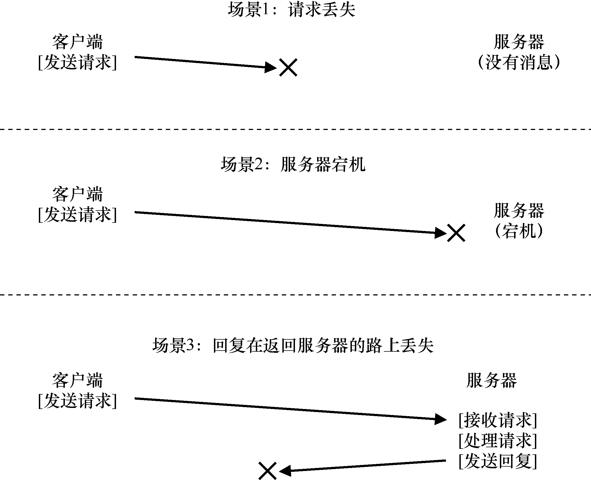

# 48.7 利用幂等操作处理服务器故障

当客户端向服务器发送消息时，有时候不会收到回复。这种失败可能的原因很多。在某些情况下，网络可能会丢弃该消息。网络确实会丢失消息，因此请求或回复可能会丢失，所以客户端永远不会收到响应，如图48.5 所示。

也可能服务器已崩溃，因此无法响应消息。稍后，服务器将重新启动，并再次开始运行，但所有请求都已丢失。在所有这些情况下，客户端有一个问题：如果服务器没有及时回复，应该怎么做？

在NFSv2 中，客户端以唯一、统一和优雅的方式处理所有这些故障：就是重试请求。具体来说，在发送请求之后，客户端将计时器设置为在指定的时间之后关闭。如果在定时器关闭之前收到回复，则取消定时器，一切正常。但是，如果在收到任何回复之前计时器关闭，则客户端会假定请求尚未处理，并重新发送。如果服务器回复，一切都很好，客户端已经漂亮地处理了问题。

客户端之所以能够简单重试请求（不论什么情况导致了故障），是因为大多数NFS 请求有一个重要的特性：它们是幂等的（idempotent）。如果操作执行多次的效果与执行一次的效果相同，该操作就是幂等的。例如，如果将值在内存位置存储 3 次，与存储一次一样。因此“将值存储到内存中”是一种幂等操作。但是，如果将计数器递增 3 次，它的数量就会与递增一次不同。因此，递增计数器不是幂等的。更一般地说，任何只读取数据的操作显然都是幂等的。对更新数据的操作必须更仔细地考虑，才能确定它是否具有幂等性。

NFS 中崩溃恢复的核心在于，大多数常见操作具有幂等性。LOOKUP 和READ 请求是简单幂等的，因为它们只从文件服务器读取信息而不更新它。更有趣的是，WRITE 请求也是幂等的。例如，如果WRITE 失败，客户端可以简单地重试它。WRITE 消息包含数据、计数和（重要的）写入数据的确切偏移量。因此，可以重复多次写入，因为多次写入的结果与单次的结果相同。

通过这种方式，客户端可以用统一的方式处理所有超时。如果WRITE 请求丢失（上面的第一种情况），客户端将重试它，服务器将执行写入，一切都会好。如果在请求发送时，服务器恰好关闭，但在第二个请求发送时，服务器已重启并继续运行，则又会如愿执行（第二种情况）。最后，服务器可能实际上收到了WRITE 请求，发出写入磁盘并发送回复。此回复可能会丢失（第三种情况），导致客户端重新发送请求。当服务器再次收到请求时，它就会执行相同的操作：将数据写入磁盘，并回复它已完成该操作。如果客户端这次收到了回复，则一切正常，因此客户端以统一的方式处理了消息丢失和服务器故障。漂亮！

一点补充：一些操作很难成为幂等的。例如，当你尝试创建已存在的目录时，系统会通知你mkdir 请求已失败。因此，在NFS 中，如果文件服务器收到MKDIR 协议消息并成功执行，但回复丢失，则客户端可能会重复它并遇到该故障，实际上该操作第一次成功了，只是在重试时失败。所以，生活并不完美。

> **提示：完美是好的敌人（Voltaire 定律）**

> 即使你设计了一个漂亮的系统，有时候并非所有的特殊情况都像你期望的那样。以上面的mkdir 为例，你可以重新设计mkdir，让它具有不同的语义，从而让它成为幂等的（想想你会怎么做）。但是，为什么要这么麻烦？NFS 的设计理念涵盖了大多数重要情况，它使系统设计在故障方面简洁明了。因此，接受生活并不完美的事实，仍然构建系统，这是良好工程的标志。显然，这种智慧应该要感谢伏尔泰，他说：“一个聪明的意大利人说，最好是好的敌人。”因此我们称之为Voltaire 定律。
