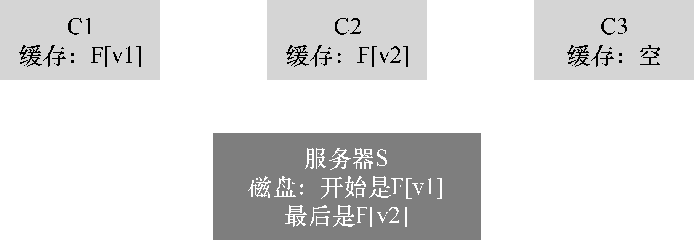

# 48.9 缓存一致性问题

利用两个客户端和一个服务器，可以很好地展示缓存一致性问题。想象一下客户端C1读取文件F，并将文件的副本保存在其本地缓存中。现在假设一个不同的客户端C2 覆盖文件F，从而改变其内容。我们称该文件的新版本为F（版本2），或F [v2]，称旧版本为F [v1]，以便区分两者。最后，还有第三个客户端C3，尚未访问文件F。

你可能会看到即将发生的问题（见图48.6）。实际上，有两个子问题。第一个子问题是，客户端C2 可能将它的写入缓存一段时间，然后再将它们发送给服务器。在这种情况下，当F[v2]位于C2 的内存中时，来自另一个客户端（比如C3）的任何对F 的访问，都会获得旧版本的文件（F[v1]）。因此，在客户端缓冲写入，可能导致其他客户端获得文件的陈旧版本，这也许不是期望的结果。实际上，想象一下你登录机器C2，更新F，然后登录C3，并尝试读取文件：只得到了旧版本！这当然会令人沮丧。因此，我们称这个方面的缓存一致性问题为“更新可见性（update visibility）”。来自一个客户端的更新，什么时候被其他客户端看见？

缓存一致性的第二个子问题是陈旧的缓存（stale cache）。在这种情况下，C2 最终将它的写入发送给文件服务器，因此服务器具有最新版本（F[v2]）。但是，C1 的缓存中仍然是F[v1]。如果运行在C1 上的程序读了文件F，它将获得过时的版本（F [v1]），而不是最新的版本（F [v2]），这（通常）不是期望的结果。

NFSv2 实现以两种方式解决了这些缓存一致性问题。首先，为了解决更新可见性，客户端实现了有时称为“关闭时刷新”（flush-on-close，即close-to-open）的一致性语义。具体来说，当应用程序写入文件并随后关闭文件时，客户端将所有更新（即缓存中的脏页面）刷新到服务器。通过关闭时刷新的一致性，NFS 可确保后续从另一个节点打开文件，会看到最新的文件版本。

其次，为了解决陈旧的缓存问题，NFSv2 客户端会先检查文件是否已更改，然后再使用其缓存内容。具体来说，在打开文件时，客户端文件系统会发出GETATTR 请求，以获取文件的属性。重要的是，属性包含有关服务器上次修改文件的信息。如果文件修改的时间晚于文件提取到客户端缓存的时间，则客户端会让文件无效（invalidate），因此将它从客户端缓存中删除，并确保后续的读取将转向服务器，取得该文件的最新版本。另外，如果客户端看到它持有该文件的最新版本，就会继续使用缓存的内容，从而提高性能。

当Sun 最初的团队实现陈旧缓存问题的这个解决方案时，他们意识到一个新问题。突然，NFS 服务器充斥着GETATTR 请求。一个好的工程原则，是为常见情况而设计，让它运作良好。这里，尽管常见情况是文件只由一个客户端访问（可能反复访问），但该客户端必须一直向服务器发送GETATTR 请求，以确没人改变该文件。客户因此“轰炸”了服务器，不断询问“有没有人修改过这个文件？”，大部分时间都没有人修改。

为了解决这种情况（在某种程度上），为每个客户端添加了一个属性缓存（attribute cache）。客户端在访问文件之前仍会验证文件，但大多数情况下只会查看属性缓存以获取属性。首次访问某文件时，该文件的属性被放在缓存中，然后在一定时间（例如3s）后超时。因此，在这3s 内，所有文件访问都会断定使用缓存的文件没有问题，并且没有与服务器的网络通信。
