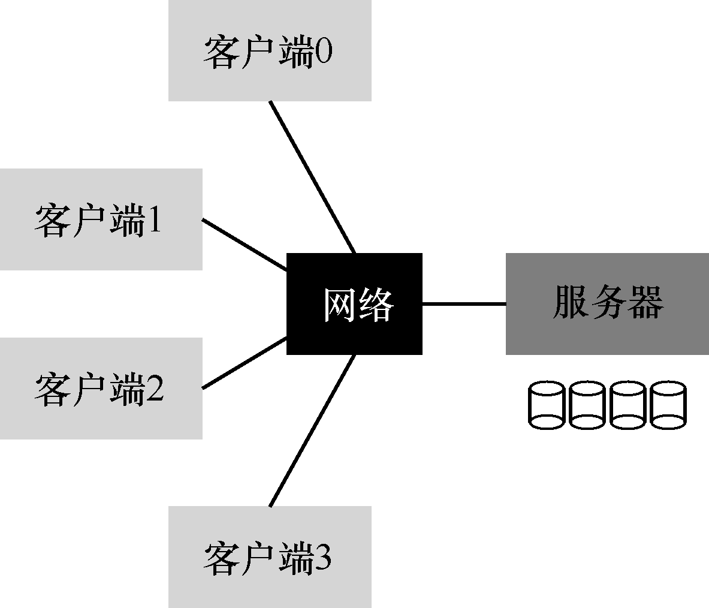

# 第 48 章 Sun的网络文件系统（NFS）

分布式客户端/服务器计算的首次使用之一，是在分布式文件系统领域。在这种环境中，有许多客户端机器和一个服务器（或几个）。服务器将数据存储在其磁盘上，客户端通过结构良好的协议消息请求数据。图48.1 展示了基本设置。

从图中可以看到，服务器有磁盘，发送消息的客户端通过网络，访问服务器磁盘上的目录和文件。为什么要麻烦，采用这种安排？（也就是说，为什么不就让客户端用它们的本地磁盘? ）好吧，这种设置允许在客户端之间轻松地共享（sharing）数据。因此，如果你在一台计算机上访问文件（客户端0），然后再使用另一台（客户端2），则你将拥有相同的文件系统视图。你可以在这些不同的机器上自然共享你的数据。第二个好处是集中管理（centralized administration）。例如，备份文件可以通过少数服务器机器完成，而不必通过众多客户端。另一个优点可能是安全（security），将所有服务器放在加锁的机房中。

> **关键问题：如何构建分布式文件系统**

> 如何构建分布式文件系统？要考虑哪些关键方面？哪里容易出错？我们可以从现有系统中学到什么？
