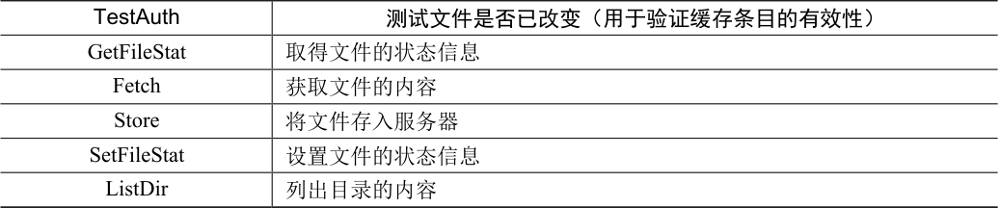

# 49.1 AFS 版本1

我们将讨论两个版本的AFS [H+88，S+85]。第一个版本（我们称之为AFSv1，但实际上原来的系统被称为ITC 分布式文件系统[S+85]）已经有了一些基本的设计，但没有像期望那样可扩展，这导致了重新设计和最终协议（我们称之为AFSv2，或就是AFS）[H+88]。现在讨论第一个版本。

所有AFS 版本的基本原则之一，是在访问文件的客户端计算机的本地磁盘（local disk）上，进行全文件缓存（whole-file caching）。当open()文件时，将从服务器获取整个文件（如果存在），并存储在本地磁盘上的文件中。后续应用程序read()和write()操作被重定向到存储文件的本地文件系统。因此，这些操作不需要网络通信，速度很快。最后，在close()时，文件（如果已被修改）被写回服务器。注意，与NFS 的明显不同，NFS 缓存块（不是整个文件，虽然NFS 当然可以缓存整个文件的每个块），并且缓存在客户端内存（不是本地磁盘）中。

让我们进一步了解细节。当客户端应用程序首次调用open()时，AFS 客户端代码（AFS设计者称之为Venus）将向服务器发送Fetch 协议消息。Fetch 协议消息会将所需文件的整个路径名（例如/home/remzi/notes.txt）传递给文件服务器（它们称为Vice 的组），然后将沿着路径名，查找所需的文件，并将整个文件发送回客户端。然后，客户端代码将文件缓存在客户端的本地磁盘上（将它写入本地磁盘）。如上所述，后续的read()和write()系统调用在AFS中是严格本地的（不与服务器进行通信）。它们只是重定向到文件的本地副本。因为read()和write()调用就像调用本地文件系统一样，一旦访问了一个块，它也可以缓存在客户端内存中。因此，AFS 还使用客户端内存来缓存它在本地磁盘中的块副本。最后，AFS 客户端完成后检查文件是否已被修改（即它被打开并写入）。如果被修改，它会用Store 协议消息，将新版本刷写回服务器，将整个文件和路径名发送到服务器以进行持久存储。

下次访问该文件时，AFSv1 的效率会更高。具体来说，客户端代码首先联系服务器（使用TestAuth 协议消息），以确定文件是否已更改。如果未更改，客户端将使用本地缓存的副本，从而避免了网络传输，提高了性能。表49.1 展示了AFSv1 中的一些协议消息。请注意，协议的早期版本仅缓存文件内容。例如，目录只保存在服务器上。

表格文字

| TestAuth | 测试文件是否已改变（用于验证缓存条目的有效性） |
| --- | --- |
| GetFileStat | 取得文件的状态信息 |
| Fetch | 获取文件的内容 |
| Store | 将文件存入服务器 |
| SetFileStat | 设置文件的状态信息 |
| ListDir | 列出目录的内容 |

