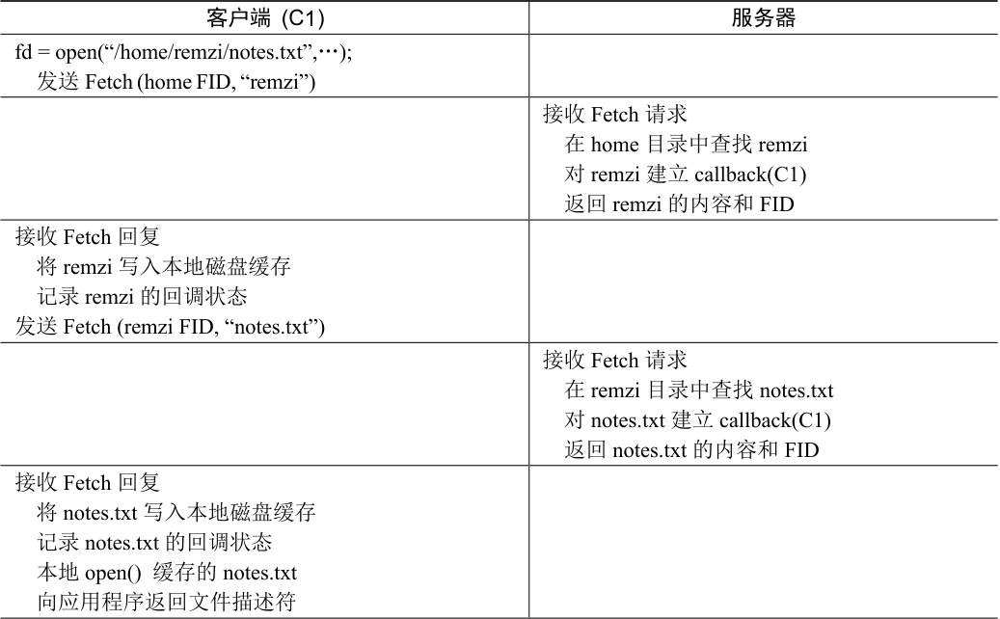

# 49.4 AFS 版本2

AFSv2 引入了回调（callback）的概念，以减少客户端/服务器交互的数量。回调就是服务器对客户端的承诺，当客户端缓存的文件被修改时，服务器将通知客户端。通过将此状态（state）添加到服务器，客户端不再需要联系服务器，以查明缓存的文件是否仍然有效。实际上，它假定文件有效，直到服务器另有说明为止。这里类似于轮询（polling）与中断（interrupt）。

AFSv2 还引入了文件标识符（File Identifier，FID）的概念（类似于NFS 文件句柄），替代路径名，来指定客户端感兴趣的文件。AFS 中的FID 包括卷标识符、文件标识符和“全局唯一标识符”（用于在删除文件时复用卷和文件ID）。因此，不是将整个路径名发送到服务器，并让服务器沿着路径名来查找所需的文件，而是客户端会沿着路径名查找，每次一个，缓存结果，从而有望减少服务器上的负载。

例如，如果客户端访问文件/home/remzi/notes.txt，并且home 是挂载在/上的AFS 目录（即/是本地根目录，但home 及其子目录在AFS 中），则客户端将先获取home 的目录内容，将它们放在本地磁盘缓存中，然后在home 上设置回调。然后，客户端将获取目录remzi，将其放入本地磁盘缓存，并在服务器上设置remzi 的回调。最后，客户端将获取notes.txt，将此常规文件缓存在本地磁盘中，设置回调，最后将文件描述符返回给调用应用程序。有关摘要，参见表49.2。

然而，与NFS 的关键区别在于，每次获取目录或文件时，AFS 客户端都会与服务器建立回调，从而确保服务器通知客户端，其缓存状态发生变化。好处是显而易见的：尽管第一次访问/home/remzi/notes.txt 会生成许多客户端—服务器消息（如上所述），但它也会为所有目录以及文件notes.txt 建立回调，因此后续访问完全是本地的，根本不需要服务器交互。因此，在客户端缓存文件的常见情况下，AFS 的行为几乎与基于本地磁盘的文件系统相同。如果多次访问一个文件，则第二次访问应该与本地访问文件一样快。

表格文字

| 客户端 (C1) | 服务器 |
| --- | --- |
| fd = open(“/home/remzi/notes.txt”,…); 发送Fetch (home FID, “remzi”) |  |
|  | 接收Fetch 请求 在home 目录中查找remzi 对remzi 建立callback(C1) 返回remzi 的内容和FID |
| 接收Fetch 回复 将remzi 写入本地磁盘缓存 记录remzi 的回调状态 发送Fetch (remzi FID, “notes.txt”) |  |
|  | 接收Fetch 请求 在remzi 目录中查找notes.txt 对notes.txt 建立callback(C1) 返回notes.txt 的内容和FID |
| 接收Fetch 回复 将notes.txt 写入本地磁盘缓存 记录notes.txt 的回调状态 本地open() 缓存的notes.txt 向应用程序返回文件描述符 |  |

read(fd, buffer, MAX);执行本地read()缓存副本close(fd);执行本地close()缓存副本如果文件已改变，刷新到服务器fd = open(“/home/remzi/notes.txt”,…);Foreach dir (home, remzi)if (callback(dir) == VALID)

使用本地副本执行lookup(dir)else Fetch (像上面一样)if (callback(notes.txt) == VALID)open 本地缓存副本return 它的文件描述符else Fetch (像上面一样) then open 并 return fd

> **补充：缓存一致性不能解决所有问题**

> 在讨论分布式文件系统时，很多都是关于文件系统提供的缓存一致性。但是，关于多个客户端访问文件，这种基本一致性并未解决所有问题。例如，如果要构建代码存储库，并且有多个客户端检入和检出代码，则不能简单地依赖底层文件系统来为你完成所有工作。实际上，你必须使用显式的文件级锁（file-level locking），以确保在发生此类并发访问时，发生“正确”的事情。事实上，任何真正关心并发更新的应用程序，都会增加额外的机制来处理冲突。本章和第48 章中描述的基本一致性主要用于随意使用，例如，当用户在不同的客户端登录时，他们希望看到文件的某个合理版本。对这些协议期望过多，会让自己陷入挫败、失望和泪流满面的沮丧。
