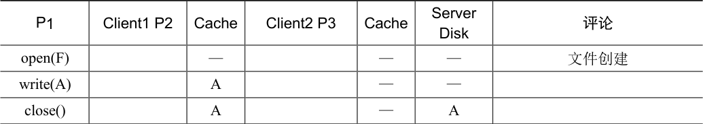
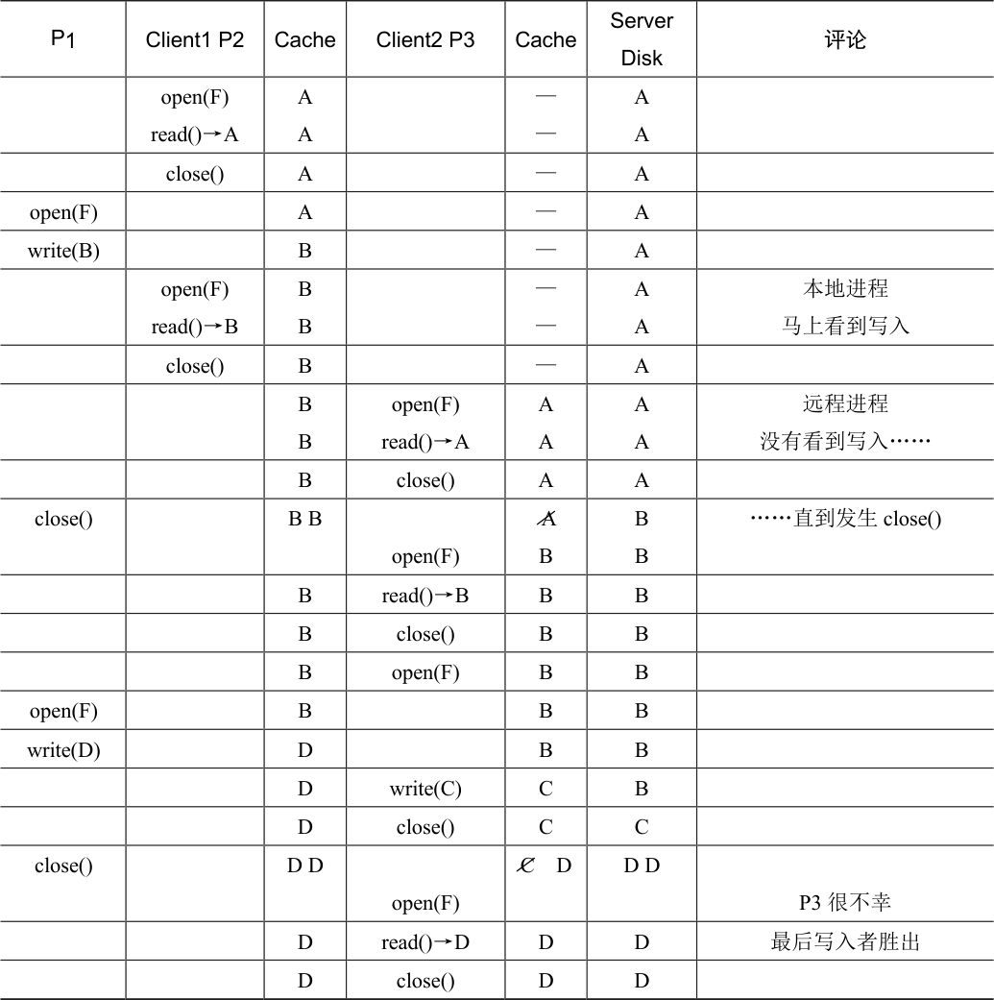

# 49.5 缓存一致性

讨论NFS 时，我们考虑了缓存一致性的两个方面：更新可见性（update visibility）和缓存陈旧（cache staleness）。对于更新可见性，问题是：服务器何时用新版本的文件进行更新？对于缓存陈旧，问题是：一旦服务器有新版本，客户端看到新版本而不是旧版本缓存副本，需要多长时间？

由于回调和全文件缓存，AFS 提供的缓存一致性易于描述和理解。有两个重要的情况需要考虑：不同机器上进程的一致性，以及同一台机器上进程的一致性。

在不同的计算机之间，AFS 让更新在服务器上可见，并在同一时间使缓存的副本无效，即在更新的文件被关闭时。客户端打开一个文件，然后写入（可能重复写入）。当它最终关闭时，新文件被刷新到服务器（因此可见）。然后，服务器中断任何拥有缓存副本的客户端的回调，从而确保客户端不再读取文件的过时副本。在这些客户端上的后续打开，需要从服务器重新获取该文件的新版本。

对于这个简单模型，AFS 对同一台机器上的不同进程进行了例外处理。在这种情况下，对文件的写入对于其他本地进程是立即可见的（进程不必等到文件关闭，就能查看其最新更新版本）。这让使用单个机器完全符合你的预期，因为此行为基于典型的UNIX 语义。只有切换到不同的机器时，你才会发现更一般的AFS 一致性机制。

有一个有趣的跨机器场景值得进一步讨论。具体来说，在极少数情况下，不同机器上的进程会同时修改文件，AFS 自然会采用所谓的“最后写入者胜出”方法（last writer win，也许应该称为“最后关闭者胜出”，last closer win）。具体来说，无论哪个客户端最后调用close()，将最后更新服务器上的整个文件，因此将成为“胜出”文件，即保留在服务器上，供其他人查看。结果是文件完全由一个客户端或另一个客户端生成。请注意与基于块的协议（如NFS）的区别：在NFS 中，当每个客户端更新文件时，可能会将各个块的写入刷新到服务器，因此服务器上的最终文件最终可能会混合为来自两个客户的更新。在许多情况下，这样的混合文件输出没有多大意义，例如，想象一个JPEG 图像被两个客户端分段修改，导致的混合写入不太可能构成有效的JPEG。

在表49.3 中可以看到，展示其中一些不同场景的时间线。这些列展示了Client1 上的两个进程（P1 和P2）的行为及其缓存状态，Client2 上的一个进程（P3）及其缓存状态，以及服务器（Server），它们都在操作一个名为的F 文件。对于服务器，该表只展示了左边的操作完成后该文件的内容。仔细查看，看看你是否能理解每次读取的返回结果的原因。如果想不通，右侧的“评论”字段对你会有所帮助。

表格文字

| P1 | Client1 P2 | Cache | Client2 P3 | Cache | Server Disk | 评论 |
| --- | --- | --- | --- | --- | --- | --- |
| open(F) |  | — |  | — | — | 文件创建 |
| write(A) |  | A |  | — | — |  |
| close() |  | A |  | — | A |  |

续表

表格文字

| P1 | Client1 P2 | Cache | Client2 P3 | Cache | Server Disk | 评论 |
| --- | --- | --- | --- | --- | --- | --- |
|  | open(F) read()→A | A A |  | — — | A A |  |
|  | close() | A |  | — | A |  |
| open(F) |  | A |  | — | A |  |
| write(B) |  | B |  | — | A |  |
|  | open(F) read()→B | B B |  | — — | A A | 本地进程 马上看到写入 |
|  | close() | B |  | — | A |  |
|  |  | B B | open(F) read()→A | A A | A A | 远程进程 没有看到写入…… |
|  |  | B | close() | A | A |  |
| close() |  | B B | open(F) | A B | B B | ……直到发生close() |
|  |  | B | read()→B | B | B |  |
|  |  | B | close() | B | B |  |
|  |  | B | open(F) | B | B |  |
| open(F) |  | B |  | B | B |  |
| write(D) |  | D |  | B | B |  |
|  |  | D | write(C) | C | B |  |
|  |  | D | close() | C | C |  |
| close() |  | D D | open(F) | C D | D D | P3 很不幸 |
|  |  | D | read()→D | D | D | 最后写入者胜出 |
|  |  | D | close() | D | D |  |

