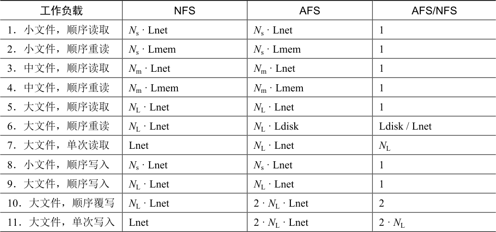

# 49.7 AFSv2 的扩展性和性能

有了新协议，人们对AFSv2 进行了测量，发现它比原来的版本更具可扩展性。实际上，每台服务器可以支持大约50 个客户端（而不是仅仅20 个）。另一个好处是客户端性能通常非常接近本地性能，因为在通常情况下，所有文件访问都是本地的。文件读取通常转到本地磁盘缓存（可能还有本地内存）。只有当客户端创建新文件或写入现有文件时，才需要向服务器发送Store 消息，从而用新内容更新文件。

对于常见的文件系统访问场景，通过与NFS 进行比较，可以对AFS 的性能有所了解。表49.4 展示了定性比较的结果。

表格文字

| 工作负载 | NFS | AFS | AFS/NFS |
| --- | --- | --- | --- |
| 1．小文件，顺序读取 | Ns · Lnet | Ns · Lnet | 1 |
| 2．小文件，顺序重读 | Ns · Lmem | Ns · Lmem | 1 |
| 3．中文件，顺序读取 | Nm · Lnet | Nm · Lnet | 1 |
| 4．中文件，顺序重读 | Nm · Lmem | Nm · Lmem | 1 |
| 5．大文件，顺序读取 | NL · Lnet | NL · Lnet | 1 |
| 6．大文件，顺序重读 | NL · Lnet | NL · Ldisk | Ldisk / Lnet |
| 7．大文件，单次读取 | Lnet | NL · Lnet | NL |
| 8．小文件，顺序写入 | Ns · Lnet | Ns · Lnet | 1 |
| 9．大文件，顺序写入 | NL · Lnet | NL · Lnet | 1 |
| 10．大文件，顺序覆写 | NL · Lnet | 2 · NL · Lnet | 2 |
| 11．大文件，单次写入 | Lnet | 2 · NL · Lnet | 2 · NL |

在表中，我们分析了不同大小的文件的典型读写模式。小文件中有NS 块，中等文件有NM 个块，大文件有NL 块。假设中小型文件可以放入客户端的内存，大文件可以放入本地磁盘，但不能放入客户端内存。

为了便于分析，我们还假设，跨网络访问远程服务器上的文件块，需要的时间为Lnet。访问本地内存需要Lmem，访问本地磁盘需要Ldisk。一般假设是Lnet &gt; Ldisk &gt; Lmem。

最后，我们假设第一次访问文件没有任何缓存命中。如果相关高速缓存具有足够容量来保存文件，则假设后续文件访问（即“重新读取”）将在高速缓存中命中。

该表的列展示了特定操作（例如，小文件顺序读取）在NFS 或AFS 上的大致时间。最右侧的列展示了AFS 与NFS 的比值。

我们有以下观察结果。首先，在许多情况下，每个系统的性能大致相当。例如，首次读取文件时（即工作负载1、3、5），从远程服务器获取文件的时间占主要部分，并且两个系统上差不多。在这种情况下，你可能会认为AFS 会更慢，因为它必须将文件写入本地磁盘。但是，这些写入由本地（客户端）文件系统缓存来缓冲，因此上述成本可能不明显。同样，你可能认为从本地缓存副本读取AFS 会更慢，因为AFS 会将缓存副本存储在磁盘上。但是，AFS 再次受益于本地文件系统缓存。读取AFS 可能会命中客户端内存缓存，性能与NFS 类似。

其次，在大文件顺序重新读取时（工作负载6），出现了有趣的差异。由于AFS 具有大型本地磁盘缓存，因此当再次访问该文件时，它将从磁盘缓存中访问该文件。相反，NFS只能在客户端内存中缓存块。结果，如果重新读取大文件（即比本地内存大的文件），则NFS客户端将不得不从远程服务器重新获取整个文件。因此，假设远程访问确实比本地磁盘慢，AFS 在这种情况下比NFS 快一倍。我们还注意到，在这种情况下，NFS 会增加服务器负载，这也会对扩展产生影响。

第三，我们注意到，（新文件的）顺序写入应该在两个系统上性能差不多（工作负载8、9）。在这种情况下，AFS 会将文件写入本地缓存副本。当文件关闭时，AFS 客户端将根据协议强制写入服务器。NFS 将缓冲写入客户端内存，可能由于客户端内存压力，会强制将某些块写入服务器，但在文件关闭时肯定会将它们写入服务器，以保持NFS 的关闭时刷新的一致性。你可能认为AFS 在这里会变慢，因为它会将所有数据写入本地磁盘。但是，要意识到它正在写入本地文件系统。这些写入首先提交到页面缓存，并且只是稍后（在后台）提交到磁盘，因此AFS 利用了客户端操作系统内存缓存基础结构的优势，提高了性能。

第四，我们注意到AFS 在顺序文件覆盖（工作负载10）上表现较差。之前，我们假设写入的工作负载也会创建一个新文件。在这种情况下，文件已存在，然后被覆盖。对于AFS来说，覆盖可能是一个特别糟糕的情况，因为客户端先完整地提取旧文件，只是为了后来覆盖它。相反，NFS 只会覆盖块，从而避免了初始的（无用）读取[^p467-1]。

最后，访问大型文件中的一小部分数据的工作负载，在NFS 上比AFS 执行得更好（工作负载7、11）。在这些情况下，AFS 协议在文件打开时获取整个文件。遗憾的是，只进行了一次小的读写操作。更糟糕的是，如果文件被修改，整个文件将被写回服务器，从而使性能影响加倍。NFS 作为基于块的协议，执行的I/O 与读取或写入的大小成比例。

总的来说，我们看到NFS 和AFS 做出了不同的假设，并且因此实现了不同的性能结果，这不意外。这些差异是否重要，总是要看工作负载。

[^p467-1]: 我们假设NFS 读取是按照块大小和块对齐的。如果不是，NFS 客户端也必须先读取该块。我们还假设文件未使用O\_TRUNC标志打开。如果是，AFS 中的初始打开也不会获取即将被截断的文件内容。
