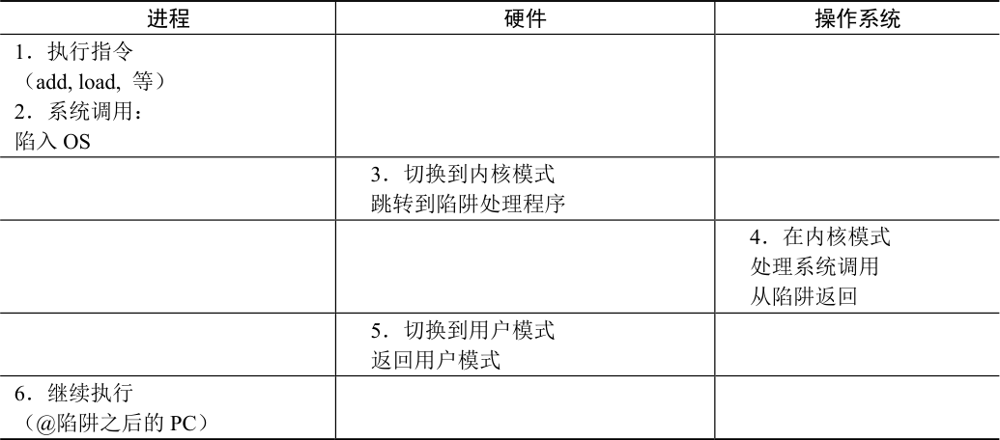
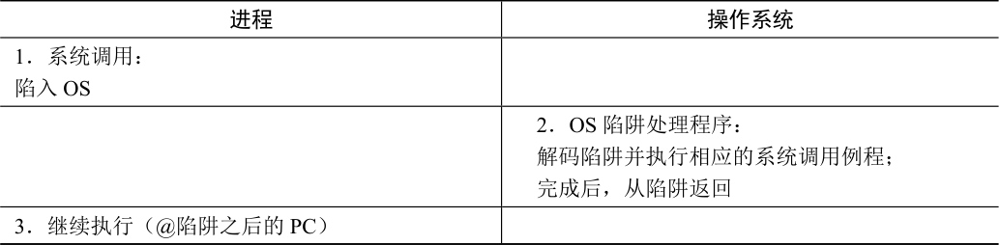
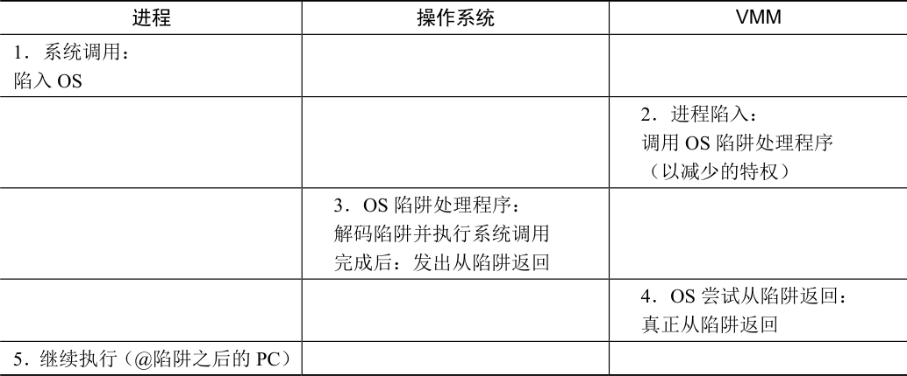

# B.3 虚拟化CPU

为了在虚拟机监视器上运行虚拟机（virtual machine，即OS 及其应用程序），使用的基本技术是受限直接执行（limited direct execution），这是我们在讨论操作系统如何虚拟化CPU时看到的技术。因此，如果想在VMM 之上“启动”新操作系统，只需跳转到第一条指令的地址，并让操作系统开始运行，就这么简单。

假设我们在单个处理器上运行，并且希望在两个虚拟机之间进行多路复用，即在两个操作系统和它们各自的应用程序之间进行多路复用。非常类似于操作系统在运行进程之间切换的方式（上下文切换，context switch），虚拟机监视器必须在运行的虚拟机之间执行机器切换（machine switch）。因此，当执行这样的切换时，VMM 必须保存一个OS 的整个机器状态（包括寄存器，PC，并且与上下文切换不同，包括所有特权硬件状态），恢复待运行虚拟机的机器状态，然后跳转到待运行虚拟机的PC，完成切换。注意，待运行VM 的PC可能在OS 本身内（系统正在执行系统调用），或可能就在该OS 上运行的进程内（用户模式应用程序）。

当正在运行的应用程序或操作系统尝试执行某种特权操作（privileged operation）时，我们会遇到一些稍微棘手的问题。例如，在具有软件管理的TLB 的系统上，操作系统将使用特殊的特权指令，用一个地址转换来更新TLB，再重新执行遇到TLB 未命中的指令。在虚拟化环境中，不允许操作系统执行特权指令，因为它控制机器而不是其下的VMM。因此，VMM 必须以某种方式拦截执行特权操作的尝试，从而保持对机器的控制。

如果在给定OS 上的运行进程尝试进行系统调用，会出现VMM 必须如何介入某些操作的简单场景。例如，进程可能尝试对一个文件调用open()，或者可能调用read()，从中获取数据，或者可能正在调用fork()来创建新进程。在没有虚拟化的系统中，通过特殊指令实现系统调用。在MIPS 上，它是一个陷阱（trap）指令。在x86 上，它是带有参数0x80 的int（中断）指令。下面是FreeBSD 上的open 库调用[B00]（回想一下，你的C 代码首先对C 库进行库调用，然后执行正确的汇编序列，实际发出陷阱指令并进行系统调用）：

```c
open:
    push    dword mode
    push    dword flags
    push    dword path
    mov     eax, 5
    push    eax
    int     80h
```

在基于UNIX 的系统上，open()只接受3 个参数：int open(char \* path, int flags, mode\_t mode)。你可以在上面的代码中看到open()库调用是如何实现的：首先，将数据推入栈（模式，标志，路径），然后将5 推入栈，然后调用int 80h，它将控制权转移到内核。如果你想知道，5 是用户模式应用程序与FreeBSD 中open()系统调用的内核之间预先商定的约定。不同的系统调用会在调用陷阱指令int 之前将不同的数字放在栈上（在相同的位置），从而进行系统调用[^p475-1]。

执行陷阱指令时，正如之前讨论的那样，它通常会做很多有趣的事情。在我们的示例中，最重要的是它首先将控制转移（即更改PC）到操作系统内定义良好的陷阱处理程序（trap handler）。操作系统开始启动时，会利用硬件（也是特权操作）建立此类例程的地址，因此在后续的陷阱中，硬件知道从哪里开始运行代码来处理陷阱。在陷阱的同时，硬件还做了另一件至关重要的事情：它将处理器的模式从用户模式（user mode）更改为内核模式（kernel mode）。在用户模式下，操作受到限制，尝试执行特权操作将导致陷阱，并可能终止违规进程。另一方面，在内核模式下，机器的全部能力都可用，因此可以执行所有特权操作。因此，在传统设置中（同样，没有虚拟化），控制流程如表B.1 所示。

表B.1 执行系统调用



<details markdown="1">
<summary>表格文字</summary>

| 进程 | 硬件 | 操作系统 |
| --- | --- | --- |
| 1．执行指令 （add, load, 等） 2．系统调用： 陷入OS |  |  |
|  | 3．切换到内核模式 跳转到陷阱处理程序 |  |
|  |  | 4．在内核模式 处理系统调用 从陷阱返回 |
|  | 5．切换到用户模式 返回用户模式 |  |
| 6．继续执行 （@陷阱之后的PC） |  |  |

</details>

在虚拟化平台上，事情会更有趣。如果在OS 上运行的应用程序希望执行系统调用，它会执行完全相同的操作：执行陷阱指令，并将参数小心地放在栈上（或寄存器中）。但是，VMM 控制机器，因此安装了陷阱处理程序的VMM 将首先在内核模式下执行。

那么VMM 应该如何处理这个系统调用呢？VMM 并不真正知道如何（how）处理调用。毕竟，它不知道正在运行的每个操作系统的细节，因此不知道每个调用应该做什么。然而，VMM 知道的是OS 的陷阱处理程序在哪里（where）。它知道这一点，因为当操作系统启动时，它试图安装自己的陷阱处理程序。当操作系统这样做时，它试图执行一些特权操作，因此陷入VMM 中。那时，VMM 记录了必要的信息（即这个OS 的陷阱处理程序在内存中的位置）。现在，当VMM 从在给定操作系统上运行的用户进程接收到陷阱时，它确切地知道该做什么：它跳转到操作系统的陷阱处理程序，并让操作系统按原样处理系统调用。当操作系统完成时，它会执行某种特权指令从陷阱返回（在MIPS 上是rett，在x86 上是iret），然后再次弹回VMM，然后VMM 意识到操作系统正试图从陷阱返回，从而执行一次真正的从陷阱返回，从而将控制返回给用户，并让机器返回用户模式。表B.2 和表B.3 描述了整个过程，无论是没有虚拟化的正常情况，还是虚拟化的情况（上面省略了具体的硬件操作，以节省空间）。

表B.2 没有虚拟化的系统调用流程



<details markdown="1">
<summary>表格文字</summary>

| 进程 | 操作系统 |
| --- | --- |
| 1．系统调用： 陷入OS |  |
|  | 2．OS 陷阱处理程序： 解码陷阱并执行相应的系统调用例程； 完成后，从陷阱返回 |
| 3．继续执行（@陷阱之后的PC） |  |

</details>

表B.3 有虚拟化的系统调用流程



<details markdown="1">
<summary>表格文字</summary>

| 进程 | 操作系统 | VMM |
| --- | --- | --- |
| 1．系统调用： 陷入OS |  |  |
|  |  | 2．进程陷入： 调用OS 陷阱处理程序 （以减少的特权） |
|  | 3．OS 陷阱处理程序： 解码陷阱并执行系统调用 完成后：发出从陷阱返回 |  |
|  |  | 4．OS 尝试从陷阱返回： 真正从陷阱返回 |
| 5．继续执行（@陷阱之后的PC） |  |  |

</details>

从表中可以看出，虚拟化时必须做更多的工作。当然，由于额外的跳转，虚拟化可能确实会减慢系统调用，从而可能影响性能。

你可能还注意到，我们还有一个问题：操作系统应该运行在什么模式？它无法在内核模式下运行，因为这可以无限制地访问硬件。因此，它必须以比以前更少的特权模式运行，能够访问自己的数据结构，同时阻止从用户进程访问其数据结构。

在Disco 的工作中，Rosenblum 及其同事利用MIPS 硬件提供的特殊模式（称为管理员模式），非常巧妙地处理了这个问题。在此模式下运行时，仍然无法访问特权指令，但可以访问比在用户模式下更多的内存。操作系统可以将这个额外的内存用于其数据结构，一切都很好。在没有这种模式的硬件上，必须以用户模式运行OS 并使用内存保护（页表和TLB），来适当地保护OS 的数据结构。换句话说，当切换到OS 时，监视器必须通过页表保护，让OS 数据结构的内存对OS 可用。当切换回正在运行的应用程序时，必须删除读取和写入内核的能力。

[^p475-1]: 使用术语“中断”来表示几乎任何理智的人都会称之为陷阱的指令，这让事情变得混乱。正如Patterson 曾说英特尔指令集是“只有母亲才爱的ISA。”但实际上，我们有点喜欢它，但我们不是它的母亲。
