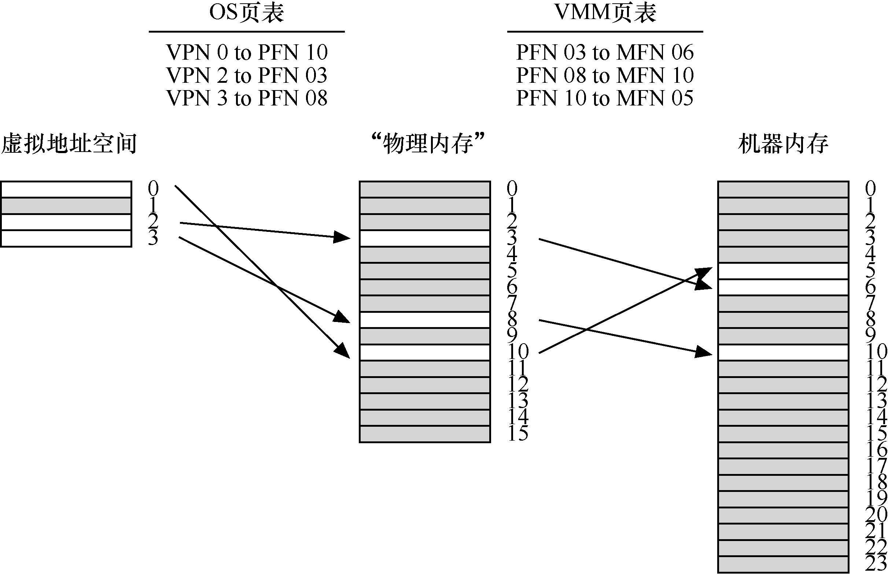
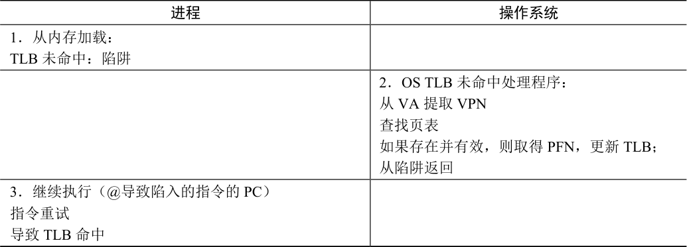
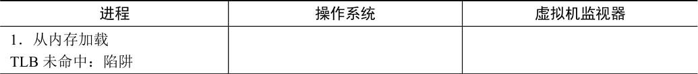
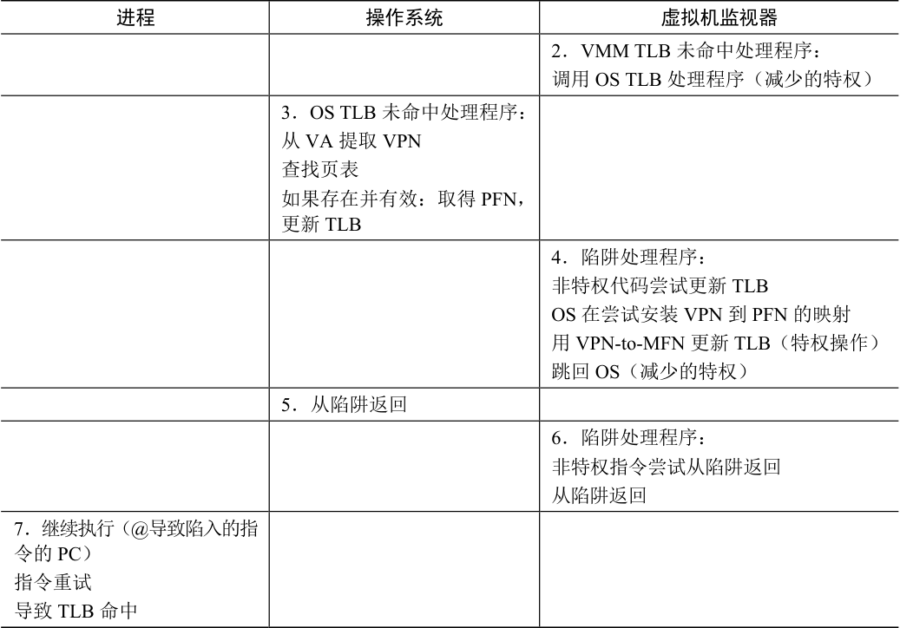

# B.4 虚拟化内存

你现在应该对处理器的虚拟化方式有了基本的了解：VMM 就像一个操作系统，安排不同的虚拟机运行。当特权级别发生变化时，会发生一些有趣的交互。但我们忽略了很大一部分：VMM 如何虚拟化内存？

每个操作系统通常将物理内存视为一个线性的页面数组，并将每个页面分配给自己或用户进程。当然，操作系统本身已经为其运行的进程虚拟化了内存，因此每个进程都有自己的私有地址空间的假象。现在我们必须添加另一层虚拟化，以便多个操作系统可以共享机器的实际物理内存，我们必须透明地这样做。

这个额外的虚拟化层使“物理”内存成为一个虚拟化层，在VMM 所谓的机器内存（machine memory）之上，机器内存是系统的真实物理内存。因此，我们现在有一个额外的间接层：每个操作系统通过其每个进程的页表映射虚拟到物理地址，VMM 通过它的每个OS 页面表，将生成的物理地址映射到底层机器地址。图B.1 描述了这种额外的间接层。

图B.1 VMM 内存虚拟化

在该图中，只有一个虚拟地址空间，包含4 个页面，其中3 个是有效的（0、2 和3）。操作系统使用其页面表将这些页面映射到3 个底层物理帧（分别为10、3 和8）。在OS 之下，VMM 提供进一步的间接级别，将PFN 3、8 和10 分别映射到机器帧6、10 和5。当然，这张图简化了一些事情。在真实系统上，会运行V 个操作系统（V 可能大于1），因有此V个VMM 页表。此外，在每个运行的操作系统OSi 之上，将有许多进程Pi 运行（Pi 可能是数十或数百），因此OSi 内有Pi 个（每进程）页表。

为了理解它如何更好地工作，让我们回想一下地址转换（address translation）在现代分页系统中的工作原理。具体来说，让我们讨论在具有软件管理的TLB 的系统上，在地址转换期间发生的情况。假设用户进程生成一个地址（用于指令获取或显式加载或存储）。根据定义，该进程生成虚拟地址（virtual address），因为其地址空间已由OS 虚拟化。如你所知，操作系统的作用是在硬件的帮助下将其转换为物理地址（virtual address），从而能够从物理内存中获取所需的内容。

假设有一个32 位的虚拟地址空间和4-KB 的页面大小。因此，32 位地址被分成两部分：一个20 位的虚拟页号（VPN）和一个12 位的偏移量。在硬件TLB 的帮助下，OS 的作用是将VPN 转换为有效的物理页帧号（PFN），从而产生完全形式的物理地址，可以将其发送到物理内存以获取正确的数据。在通常情况下，我们希望TLB 能够处理硬件中的转换，从而快速实现转换。当TLB 未命中时（至少在具有软件管理的TLB 的系统上），操作系统必须参与处理未命中，如表B.4 所示。

表B.4 没有虚拟化的TLB 未命中流程

表格文字

| 进程 | 操作系统 |
| --- | --- |
| 1．从内存加载： TLB 未命中：陷阱 |  |
|  | 2．OS TLB 未命中处理程序： 从VA 提取VPN 查找页表 如果存在并有效，则取得PFN，更新TLB； 从陷阱返回 |
| 3．继续执行（@导致陷入的指令的PC） 指令重试 导致TLB 命中 |  |

如你所见，TLB 未命中会导致陷入操作系统，操作系统在页表中查找VPN，将转换映射装入TLB，来处理该故障。

然而，操作系统之下有虚拟机监视器时，事情变得更有趣了。我们再来看看TLB 未命中的流程（参见表B.5 的总结）。当进程进行虚拟内存引用，并导致TLB 未命中时，运行的不是OS TLB 的未命中处理程序。实际上，运行的是VMM TLB 未命中处理程序，因为VMM是机器的真正特权所有者。但是，在正常情况下，VMM TLB 处理程序不知道如何处理TLB未命中，因此它立即跳转到OS TLB 未命中处理程序。VMM 知道此处理程序的位置，因为操作系统在“启动”期间尝试安装自己的陷阱处理程序。然后运行OS TLB 未命中处理程序，对有问题的VPN 执行页表查找，并尝试在TLB 中安装VPN 到PFN 映射。但是，这样做是一种特权操作，因此导致另一次陷入VMM（当任何非特权代码尝试执行特权时，VMM 都会得到通知）。此时，VMM 玩了花样：VMM 不是安装操作系统的VPN-to-PFN 映射，而是安装其所需的VPN-to-MFN 映射。这样做之后，系统最终返回到用户级代码，该代码重试该指令，并导致TLB 命中，从数据所在的机器帧中获取数据。

表B.5 有虚拟化的TLB 未命中流程

表格文字

| 进程 | 操作系统 | 虚拟机监视器 |
| --- | --- | --- |
| 1．从内存加载 TLB 未命中：陷阱 |  |  |

续表

表格文字

| 进程 | 操作系统 | 虚拟机监视器 |
| --- | --- | --- |
|  |  | 2．VMM TLB 未命中处理程序： 调用OS TLB 处理程序（减少的特权） |
|  | 3．OS TLB 未命中处理程序： 从VA 提取VPN 查找页表 如果存在并有效：取得PFN， 更新TLB |  |
|  |  | 4．陷阱处理程序： 非特权代码尝试更新TLB OS 在尝试安装VPN 到PFN 的映射 用VPN-to-MFN 更新TLB（特权操作） 跳回OS（减少的特权） |
|  | 5．从陷阱返回 |  |
|  |  | 6．陷阱处理程序： 非特权指令尝试从陷阱返回 从陷阱返回 |
| 7．继续执行（@导致陷入的指 令的PC） 指令重试 导致TLB 命中 |  |  |

这组操作还暗示了，对于每个正在运行的操作系统的物理内存，VMM 必须如何管理虚拟化。就像操作系统有每个进程的页表一样，VMM 必须跟踪它运行的每个虚拟机的物理到机器映射。在VMM TLB 未命中处理程序中，需要查阅每个机器的页表，以便确定特定“物理”页面映射到哪个机器页面，甚至它当前是否存在于机器内存中（例如，VMM 可能已将其交换到磁盘）。

> **补充：管理程序和硬件管理的TLBS**

> 我们的讨论集中在软件管理的TLB 以及发生未命中时需要完成的工作。但你可能想知道：有硬件管理的TLB 时，虚拟机监视器如何参与？在这些系统中，硬件在每个TLB 未命中时遍历页表并根据需要更新TLB，因此VMM 没有机会在每个TLB 未命中时运行以将其转换到系统中。作为替代，VMM 必须密切监视操作系统对每个页表的更改（在硬件管理的系统中，由某种类型的页表基址寄存器指向），并保留一个影子页表（shadow page table），它将每个进程的虚拟地址映射到VMM 期望的机器页面[AA06]。每当操作系统尝试安装进程的操作系统级页表时，VMM 就会安装进程的影子页表，然后硬件干活，利用影子表将虚拟地址转换为机器地址，而操作系统甚至没有注意到。

最后，你可能注意到，在这一系列操作中，虚拟化系统上的TLB 未命中变得比非虚拟化系统更昂贵一点。为了降低这一成本，Disco 的设计人员增加了一个VMM 级别的“软件TLB”。这种数据结构背后的想法很简单。VMM 记录它看到操作系统尝试安装的每个虚拟到物理的映射。然后，在TLB 未命中时，VMM 首先查询其软件TLB 以查看它是否已经看到此虚拟到物理映射，以及VMM 所需的虚拟到机器的映射应该是什么。如果VMM 在其软件TLB 中找到转换，就将虚拟到机器的映射直接装入硬件TLB 中，因此跳过了上面控制流中的所有来回[B+97]。
